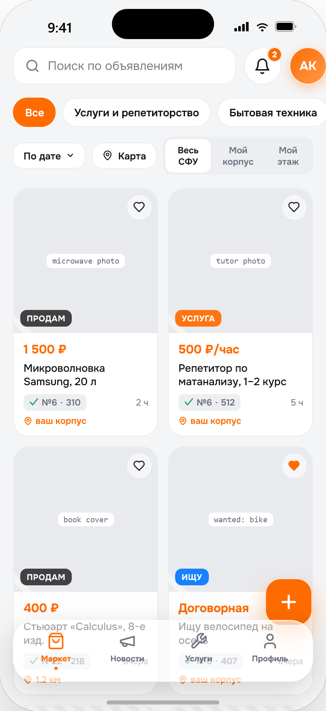
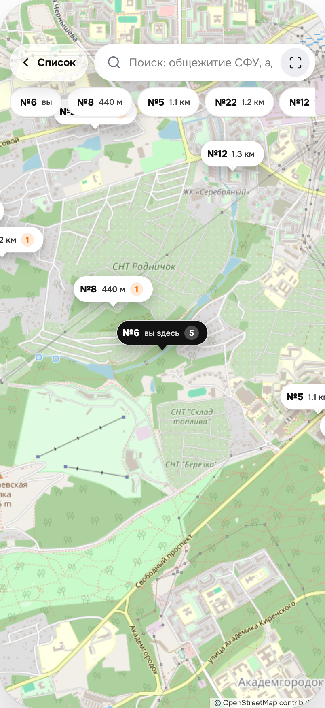
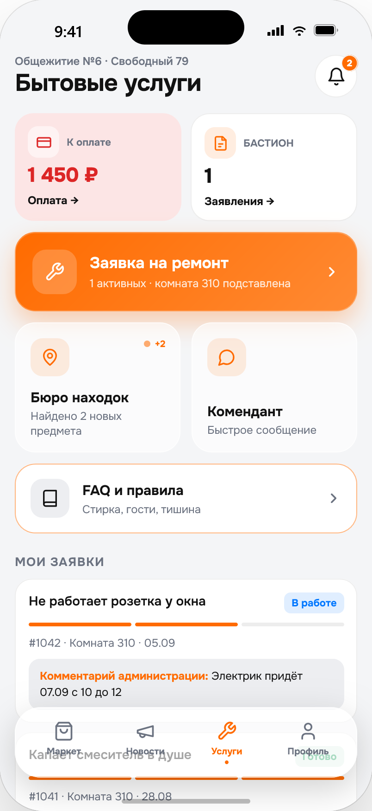

# Dorm Campus

Открытая платформа для цифровизации студенческого общежития. Проект объединяет мобильное приложение с личным кабинетом студента, рабочее место сотрудников общежития и панель руководства.


Изначально приложение создавалось как прототип единого сервиса для общежитий Сибирского федерального университета. Его задача — собрать в одном месте бытовые, учебные и административные процессы, ради которых студентам обычно приходится пользоваться несколькими сайтами, чатами и бумажными заявлениями.

> Проект не является официальным продуктом СФУ. Названия, данные и интеграции в репозитории используются в демонстрационных целях. Перед промышленным запуском подключите реальные SSO, платежи и университетские информационные системы.

## Интерфейс

<p align="center">
  
  
  
</p>

Маркетплейс помогает студентам обмениваться вещами и услугами, интерактивная карта показывает корпуса и объявления, а единый раздел услуг собирает платежи, ремонт, обращения и повседневные сервисы общежития.

## Возможности

### Личный кабинет студента

- профиль проживающего, данные договора и уведомления;
- объявления, избранное, поиск по категориям и карте общежитий;
- личные и общие чаты, новости и мероприятия;
- заявки на ремонт с фотографиями, обращения, потерянные вещи;
- оплата проживания и история платежей;
- расписание группы, зачётная книжка и заказ документов;
- бронирование прачечной, спортзала и психологической службы;
- меню столовой, поиск соседа и обмен комнатой.

### Сотрудники общежития

- обзор заселения, задолженностей и предстоящих выездов;
- база жильцов и назначение ответственных ролей;
- обработка ремонтов, обращений и сообщений;
- рассылки, новости и мероприятия;
- бухгалтерские счета и связь с руководством;
- мобильная панель сотрудника и отдельная веб-панель.

### Руководство

- сводка по всем общежитиям;
- задолженности, обращения и объяснительные;
- сообщения и прямой чат с администрацией общежития.

## Состав проекта

```text
apps/
  api/       REST API, Socket.IO, Prisma и SQLite
  mobile/    Expo / React Native приложение для студентов и сотрудников
  admin/     React / Vite веб-панель администрации
packages/
  shared/    общие типы, API-клиент, переводы, темы и данные общежитий
docs/
  ARCHITECTURE.md   устройство системы и точки интеграции
  CONFIGURATION.md настройка окружения и промышленного запуска
```

## Требования

- Node.js 20 или новее;
- npm 10 или новее;
- Expo Go для запуска мобильного приложения на телефоне;
- телефон и компьютер в одной локальной сети.

## Быстрый запуск

1. Установите зависимости и подготовьте демонстрационную базу:

```bash
npm install
npm run setup
```

2. Запустите API:

```bash
npm run dev:api
```

3. В другом терминале запустите мобильное приложение:

```bash
npm run dev:mobile
```

Отсканируйте QR-код в Expo Go. Если приложение не находит API автоматически, создайте `apps/mobile/.env` по примеру `apps/mobile/.env.example` и укажите локальный IP компьютера.

4. Для веб-панели администратора откройте третий терминал:

```bash
npm run dev:admin
```

Панель будет доступна по адресу `http://localhost:5173`.

## Демонстрационные аккаунты

Пароль для всех аккаунтов: `sfu2026`.

| Роль | Логин |
| --- | --- |
| Студент | `Example-TT26` |
| Администратор общежития | `Dorm6-Admin` |
| Староста этажа | `Sidorov-MK24` |
| Инспектор | `Nikitin-AV23` |
| Редактор новостей | `Volkova-DS26` |
| Регистратор | `Belova-OT25` |
| Руководство | `Campus-Lead` |

Все персональные данные в начальной базе вымышлены и предназначены только для демонстрации.

## Настройка

| Компонент | Переменная | Назначение |
| --- | --- | --- |
| API | `DATABASE_URL` | строка подключения Prisma; по умолчанию локальный SQLite |
| API | `JWT_SECRET` | секрет подписи токенов; обязательно заменить вне разработки |
| API | `PORT` | порт API, по умолчанию `4000` |
| API | `CORS_ORIGINS` | разрешённые origin через запятую |
| Mobile | `EXPO_PUBLIC_API_URL` | полный URL API для телефона или сборки |
| Admin | `VITE_API_URL` | полный URL API для веб-панели |

Подробности находятся в [docs/CONFIGURATION.md](docs/CONFIGURATION.md).

Чек-лист смены бренда, общежитий и интеграций: [docs/CUSTOMIZATION.md](docs/CUSTOMIZATION.md).

## Проверка проекта

```bash
npm run check
```

Команда проверяет TypeScript во всех пакетах и создаёт production-сборку веб-панели.

## Важное перед промышленным запуском

- замените демонстрационную авторизацию на OAuth/OIDC или SSO вашей организации;
- подключите платёжный провайдер и серверную проверку платежей;
- перенесите SQLite на промышленную СУБД при многопользовательской эксплуатации;
- вынесите загрузки в объектное хранилище;
- настройте HTTPS, резервное копирование, мониторинг и журналирование;
- проведите юридическую проверку обработки персональных и медицинских данных.

Подробнее о заменяемых интеграциях: [docs/ARCHITECTURE.md](docs/ARCHITECTURE.md).

## Участие в разработке

Правила локальной разработки и оформления изменений описаны в [CONTRIBUTING.md](CONTRIBUTING.md).

## Лицензия

Исходный код распространяется по лицензии MIT. См. [LICENSE](LICENSE).
